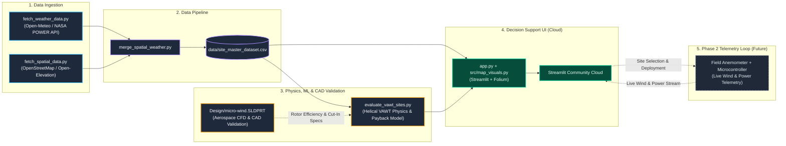

# Aero-Grid Wind AI — System Architecture

Aero-Grid is an end-to-end micro-wind turbine siting and techno-economic validation platform designed for low-wind, high-roughness rural and semi-urban environments.

## End-to-End Architecture Flowchart

## Stage Breakdown

| Stage | Component / Artifact | Responsibility |
| :--- | :--- | :--- |
| **1. Data Ingestion** | `fetch_weather_data.py`, `fetch_spatial_data.py` | Pulls multi-year wind speed, gust, temperature, and air-density time series from Open-Meteo / NASA POWER APIs alongside terrain elevation, slope, land cover, and surface roughness (`z₀`) from OpenStreetMap & Open-Elevation. |
| **2. Data Pipeline** | `merge_spatial_weather.py` → `data/site_master_dataset.csv` | Joins spatial terrain attributes with aggregated weather metrics into a unified, analysis-ready site master dataset. |
| **3. Physics, ML & CAD Validation** | `evaluate_vawt_sites.py`, `Design/micro-wind.SLDPRT` | Models Hellmann/log wind shear, Rayleigh wind power density, AEP, and INR payback for a 500W–700W Helical VAWT, informed by SolidWorks CAD & aerodynamic CFD validation. |
| **4. Decision Support UI (Cloud)** | `app.py`, `src/map_visuals.py` | Interactive Streamlit dashboard with Folium geospatial mapping, site suitability scoring, turbine hardware/hub-height estimator, and CSV export deployed on Streamlit Community Cloud. |
| **5. Phase 2 Telemetry Loop** | Field Anemometer + Microcontroller | *(Planned)* Edge sensor nodes deployed at top-ranked sites streaming real-time wind speed and power generation back to the cloud dashboard for model calibration and monitoring. |
